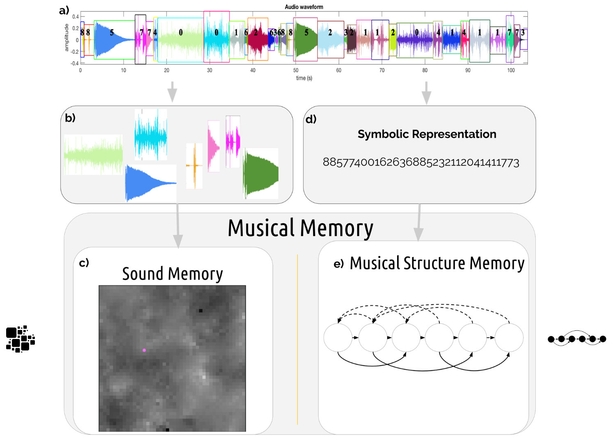
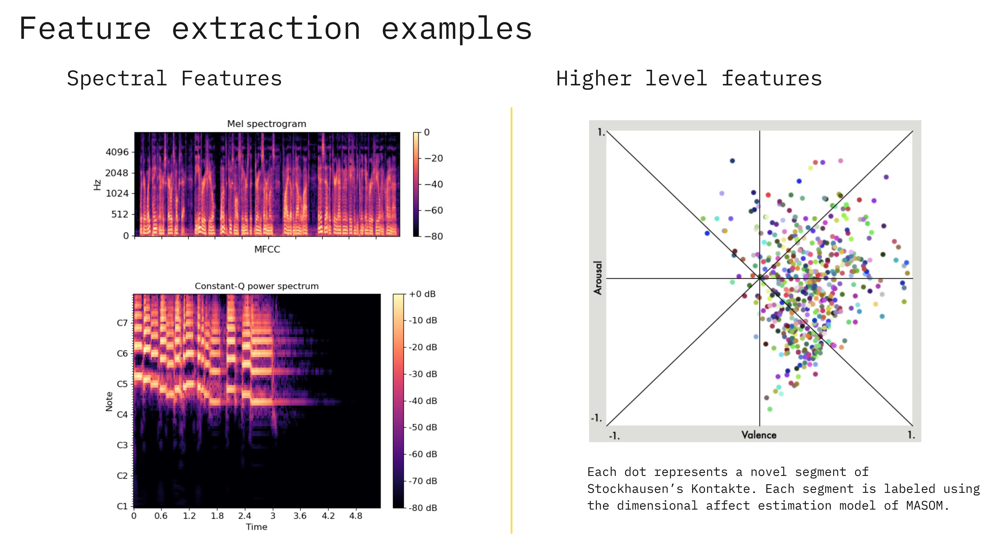
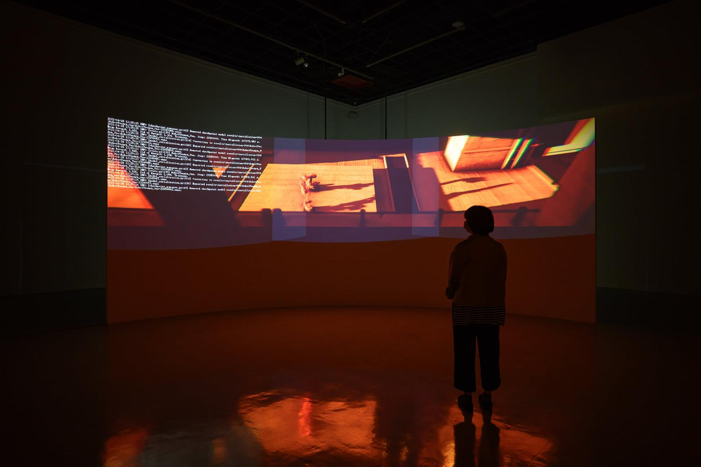
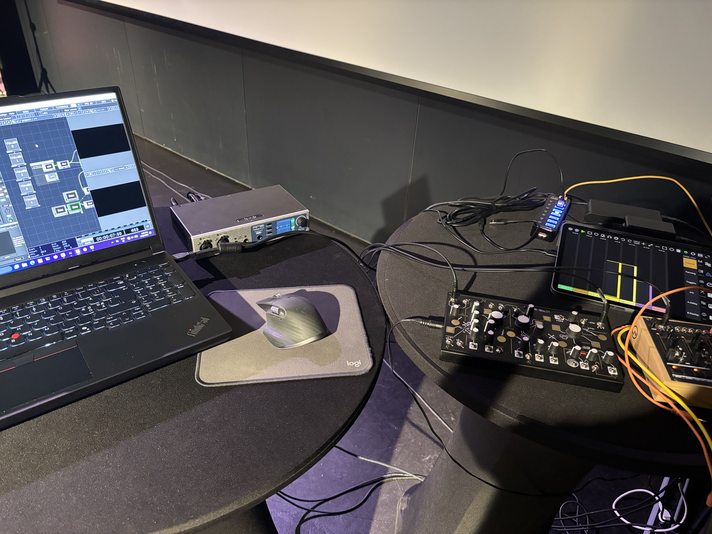

<!-- footer: <small><i>Kıvanç Tatar, Associate Professor in Interactive AI</small></i> 
 
 -->

# Machine Learning and Artificial Intelligence in the Arts and Music: A Take on Opportunities and Risks

These slides are live at: 
https://kivanctatar.com/2026-10-uniarts-ai/

---

## Upcoming, from December 2026

Professor in Digital Art with emphasis on AI and Co-Creativity

---

## Acknowledgements

| Country  | Funding Body  | Timeline |
|:---|:---|:---|
| Finland | Foundation PostScriptum , ELLIS Insitute Finland, and UniArts Helsinki | 2026- |
| Sweden | VR - Vetenskapsrådet | 2025-2031 |
| Sweden | The Wallenberg AI, Autonomous Systems, and Software Program – Humanities and Society |2021- 2030 |
| Canada | Canada Council for the Arts | 2018-2022 |
| Canada |BC Arts Council | 2020 |
| Switzerland | Swiss National Science Foundation | 2020-2021|
| Canada |Social Sciences and Humanities Research Council| 2014-2020 |
| Canada |Natural Sciences and Engineering Research Council| 2014-2019 |

---

# What does Artificial Intelligence technology encapsulate?

- Multimodal Foundation Models
- Large Language Models and Agentic AI (GPT, DeepSeek etc.)
- Reinforcement Learning (Q-learning, deep Q-networks, policy gradient methods, etc.)
- Deep Generative Models (VAEs, GANs, diffusion models, flow-based models, etc.)
- Deep Learning (ANNs, CNNs, RNNs, Transformers, etc.)
- Conventional Machine Learning (Supervised, Unsupervised, Semi-supervised learning; such as SVMs, Decision Trees, Random Forests, KNN, etc.)
- Multi-agent Systems
- Artificial Life
- Evolutionary Algorithms (Genetic Algorithms, Genetic Programming, etc.)
- Symbolic AI, Expert Systems, Rule-based Systems, etc.
  
---

#### Calculating Empires (Crawford and Joler 2023)

  <iframe
    src="https://calculatingempires.net/?pos=64626.91%2C13950.71%2C14.3640"
    title="Calculating Empires"
    style="
      position: absolute;
      inset: 0;
      width: 100%;
      height: 100%;
      border: 0;
    "
    loading="lazy"
    referrerpolicy="no-referrer-when-downgrade"
    allowfullscreen
  ></iframe>

<small>https://calculatingempires.net/?pos=64626.91%2C13950.71%2C14.3640</small>

---

# What does Artificial Intelligence technology encapsulate?

- Multimodal Foundation Models
- Large Language Models and Agentic AI (GPT, DeepSeek etc.)
- **Reinforcement Learning** (Q-learning, deep Q-networks, policy gradient methods, etc.)
- **Deep Generative Models** (VAEs, GANs, diffusion models, flow-based models, etc.)
- **Deep Learning** (ANNs, CNNs, RNNs, Transformers, etc.)
- **Conventional Machine Learning** ( such as SVMs, Decision Trees, Random Forests, KNN, etc.)
- **Multi-agent Systems**
- Artificial Life
- Evolutionary Algorithms (Genetic Algorithms, Genetic Programming, etc.)
- Symbolic AI, Expert Systems, Rule-based Systems, etc.

---

# What does Artificial Intelligence technology encapsulate?

- Multimodal Foundation Models
- Large Language Models and Agentic AI (GPT, DeepSeek etc.)
- Reinforcement Learning (Q-learning, deep Q-networks, policy gradient methods, etc.)
- Deep Generative Models (VAEs, GANs, diffusion models, flow-based models, etc.)
- Deep Learning (ANNs, CNNs, RNNs, Transformers, etc.)
- **Conventional Machine Learning** ( such as SVMs, Decision Trees, Random Forests, KNN, etc.)
- **Multi-agent Systems**
- Artificial Life
- Evolutionary Algorithms (Genetic Algorithms, Genetic Programming, etc.)
- Symbolic AI, Expert Systems, Rule-based Systems, etc.

---

<!-- _class: columns -->

## Multi-agent Systems

- Realtime and interactive
- The agency in performance can be distributed to humans and autonomous systems
- The aesthetics are flexible when the agents can be trained on a dataset

 ## + Conventional Machine Learning

- Self-Organising Maps
- Variable Markov Models or Factor Oracle

---

### A Conversation with Artificial Intelligence (2017)

<iframe width="560" height="315" src="https://www.youtube.com/embed/VLtilZ2lcIA?si=snoMz-kdBZBG7HqW" title="YouTube video player" frameborder="0" allow="accelerometer; autoplay; clipboard-write; encrypted-media; gyroscope; picture-in-picture; web-share" referrerpolicy="strict-origin-when-cross-origin" allowfullscreen></iframe>

---

#### Musical Agents based on Self-Organizing Maps (MASOM)

K. Tatar, “Musical agents based on self-organizing maps for audio applications,” Thesis, Communication, Art & Technology: School of Interactive Arts and Technology, 2019. Available: http://summit.sfu.ca/item/19665

---

#### Training a MASOM model

---

---

#### Co-Performance with MASOM

---

#### Organizing Sounds with Artificial Intelligence

<iframe width="560" height="315" src="https://www.youtube.com/embed/HyRaBvoLvnI?si=wg9CNrwCUUL_ygUl" title="YouTube video player" frameborder="0" allow="accelerometer; autoplay; clipboard-write; encrypted-media; gyroscope; picture-in-picture; web-share" referrerpolicy="strict-origin-when-cross-origin" allowfullscreen></iframe>

---

#### Dataset

<iframe style="border: 0; width: 350px; height: 470px;" src="https://bandcamp.com/EmbeddedPlayer/album=102182719/size=large/bgcol=ffffff/linkcol=0687f5/tracklist=false/transparent=true/" seamless><a href="https://kivanctatar.bandcamp.com/album/self-distruption">Self-distruption by Kıvanç Tatar</a></iframe>

---

#### A Big MASOM Family

<iframe width="560" height="315" src="https://www.youtube.com/embed/FJuMR1gtgp0?si=MJG6dQKMLkf1t1py&amp;start=410" title="YouTube video player" frameborder="0" allow="accelerometer; autoplay; clipboard-write; encrypted-media; gyroscope; picture-in-picture; web-share" referrerpolicy="strict-origin-when-cross-origin" allowfullscreen></iframe>

---

# What does Artificial Intelligence technology encapsulate?

- Multimodal Foundation Models
- Large Language Models and Agentic AI (GPT, DeepSeek etc.)
- Deep Generative Models (VAEs, GANs, diffusion models, flow-based models, etc.)
- Reinforcement Learning (Q-learning, deep Q-networks, policy gradient methods, etc.)
- **Deep Learning** (ANNs, CNNs, RNNs, Transformers, etc.)
- Conventional Machine Learning (Supervised, Unsupervised, Semi-supervised learning; such as SVMs, Decision Trees, Random Forests, KNN, etc.)
- Multi-agent Systems
- Artificial Life
- Evolutionary Algorithms (Genetic Algorithms, Genetic Programming, etc.)
- Symbolic AI, Expert Systems, Rule-based Systems, etc.
  
---

<!-- _class: columns -->

### Plastic Biosphere (2020-2021)

highlights the imperative coexistence of humankind and the material, plastics. 

In the anthropocene era, humankind created over 300 million tons of plastic every year, and this production has become a geophysical force of nature. The ubiquitous material extends beyond our reach and control, creating its own life-cycles, existing as an unignorable element of the biosphere.

 

#### AI models used

- Style imitation based on the repo *neural-style-tf*, which builds on 
  - L. A. Gatys, A. S. Ecker, and M. Bethge, “Image Style Transfer Using Convolutional Neural Networks,” in Proceedings of the IEEE Conference on Computer Vision and Pattern Recognition (CVPR), Jun. 2016.
  - M. Ruder, A. Dosovitskiy, and T. Brox, “Artistic style transfer for videos,” 2016. doi: 10.1007/978-3-319-45886-1_3. 
  - L. A. Gatys, M. Bethge, A. Hertzmann, and E. Shechtman, “Preserving Color in Neural Artistic Style Transfer,” Jun. 19, 2016, arXiv: arXiv:1606.05897. doi: 10.48550/arXiv.1606.05897.
- Musical AI by musical agents based on self-organizing maps

---

#### Plastic Biosphere No.1

<iframe width="560" height="315" src="https://www.youtube.com/embed/WIf6noBXLFM?si=STYTyyle2WVUBTbR" title="YouTube video player" frameborder="0" allow="accelerometer; autoplay; clipboard-write; encrypted-media; gyroscope; picture-in-picture; web-share" referrerpolicy="strict-origin-when-cross-origin" allowfullscreen></iframe>

---

#### Plastic Biosphere No.1 at Kepler's Gardens

<video controls src="pb-ars.mp4" width="800"></video>

---

#### Plastic Biosphere No.1 - Credits

| Author | Role |
| --- | --- |
| [Kıvanç Tatar](https://www.kivantatar.com/) | Artist, Creative AI developer |
| [Grigore Burloiu](https://cinetic.arts.ro/en/echipa/grigore-burloiu/) | Technical Director |
| [Marius Hodea](https://cinetic.arts.ro/en/echipa/marius-hodea/) | 3D Modelling |
| [Iuliana Gherghescu](https://cinetic.arts.ro/en/echipa/iuliana-gherghescu/) | Set Design |
| Andrei Gindac | Admin |
| [Assoc. Prof. Alexandru Berceanu](https://cinetic.arts.ro/en/echipa/alexandru-berceanu/) | CINETic Director |

---

#### Plastic Biosphere No.2 - Credits

| Author | Role |
| --- | --- |
| [Kıvanç Tatar](https://www.kivantatar.com/) | Artistic Director / Creative AI development |
| [Tamar Tabori](https://www.instagram.com/tamamamar) | Contemporary Dance |
| [Dan O'Shea](https://www.doshea.net/) | Technical Director |
| [Remy Siu](https://remysiu.com/) | Technical Consultant |

---

#### Plastic Biosphere No.2

<iframe width="560" height="315" src="https://www.youtube.com/embed/WIf6noBXLFM?si=STYTyyle2WVUBTbR" title="YouTube video player" frameborder="0" allow="accelerometer; autoplay; clipboard-write; encrypted-media; gyroscope; picture-in-picture; web-share" referrerpolicy="strict-origin-when-cross-origin" allowfullscreen></iframe>

---

# What does Artificial Intelligence technology encapsulate?

- Multimodal Foundation Models
- Large Language Models and Agentic AI (GPT, DeepSeek etc.)
- Deep Generative Models (VAEs, GANs, diffusion models, flow-based models, etc.)
- **Reinforcement Learning** (Q-learning, deep Q-networks, policy gradient methods, etc.)
- Deep Learning (ANNs, CNNs, RNNs, Transformers, etc.)
- Conventional Machine Learning (Supervised, Unsupervised, Semi-supervised learning; such as SVMs, Decision Trees, Random Forests, KNN, etc.)
- Multi-agent Systems
- Artificial Life
- Evolutionary Algorithms (Genetic Algorithms, Genetic Programming, etc.)
- Symbolic AI, Expert Systems, Rule-based Systems, etc.

---

<!-- _class: columns -->

### Gestalt Generation No.1 (2021)

Two robotic arms controlled by reinforcement learning agents learning intimacy and borders,

by Remy Siu and Kıvanç Tatar 

---

### Gestalt Generation No.1 - Research Process

<iframe src="https://dl.dropboxusercontent.com/s/8j6odc3y4snjtog/gestalt%20research%20trailer%20draft%202.m4v" title="Gestalt Generation No.1" frameborder="0" allow="accelerometer; autoplay; clipboard-write; encrypted-media; gyroscope; picture-in-picture; web-share" referrerpolicy="origin" allowfullscreen style="display:block; margin:1.5rem auto; width:min(100%, 742px); aspect-ratio:16/9; height:auto;"> </iframe>

---

# What does Artificial Intelligence technology encapsulate?

- Multimodal Foundation Models
- Large Language Models and Agentic AI (GPT, DeepSeek etc.)
- **Deep Generative Models** (VAEs, GANs, diffusion models, flow-based models, etc.)
- Reinforcement Learning (Q-learning, deep Q-networks, policy gradient methods, etc.)
- Deep Learning (ANNs, CNNs, RNNs, Transformers, etc.)
- Conventional Machine Learning (Supervised, Unsupervised, Semi-supervised learning; such as SVMs, Decision Trees, Random Forests, KNN, etc.)
- Multi-agent Systems
- Artificial Life
- Evolutionary Algorithms (Genetic Algorithms, Genetic Programming, etc.)
- Symbolic AI, Expert Systems, Rule-based Systems, etc.
  
---

## Deep Generative Modelling for Organized Sound 

---

#### Artistic Technology Research - What if?

# <!--fit-->What if I could synthesize sounds in between existing sounds?

---

#### Latent Timbre Synthesis (2020)

<small>https://www.youtube.com/watch?v=-1XuXbX_VZo</small>

<iframe width="800" height="450" src="https://www.youtube.com/embed/-1XuXbX_VZo?si=g7sQkcHFoc94XCwM" title="YouTube video player" frameborder="0" allow="accelerometer; autoplay; clipboard-write; encrypted-media; gyroscope; picture-in-picture; web-share" referrerpolicy="strict-origin-when-cross-origin" allowfullscreen></iframe>

---

#### Latent Timbre Synthesis 

<small> K. Tatar, D. Bisig, and P. Pasquier, “Latent Timbre Synthesis,” Neural Computing & Applications, Oct. 2020, doi: 10.1007/s00521-020-05424-2.
</small>

---

#### Latent Timbre Synthesis 

Interpolations in the latent space of the VAE

---

#### Latent Timbre Synthesis

Notes on Reproducibility

---

#### Latent Timbre Synthesis

Notes on Reproducibility

---

# <!--fit-->Most Musical AI research are ad-hoc efforts. 

---

#### Latent Timbre Synthesis

Emerging themes from the user study with 9 composers: 

- Iterative sound design in musical composition
- Musical strategies
- Musical goals and concepts
- Familiarity
- Affordances
- Sound aesthetics
- Sound quality
- User Inteface
- Tool Deficiencies
- Continued use

--- 

#### Open Questions

- How to showcase aesthetics of different models?
  - Challenge: It is impossible to hear all possibilities of a model through human listening, hence other approaches needed.
- What are emergent research threads that we could share and compare across works?

---

# <!--fit-->How do we make music with vast sound search spaces? 

---

#### Coding the Latent Artwork (2022)
https://www.youtube.com/watch?v=rfq82eKE-34&t=2810s

<iframe width="800" height="450" src="https://www.youtube.com/embed/rfq82eKE-34?si=b3xsvPWKXwDRp12e&amp;start=2810" title="YouTube video player" frameborder="0" allow="accelerometer; autoplay; clipboard-write; encrypted-media; gyroscope; picture-in-picture; web-share" referrerpolicy="strict-origin-when-cross-origin" allowfullscreen></iframe>

---

#### RawAudio Variational Autoencoder

<small> K. Tatar, K. Cotton, and D. Bisig, “Sound Design Strategies for Latent Audio Space Explorations Using Deep Learning Architectures,” presented at the Proceedings of Sound and Music Computing 2023, 2023.</small>

---

#### Coding the Latent

---

#### Coding the Latent

---

#### Music Notation and Composition with Latent Spaces (2026)

**Meta-Benjolin**

 
 
 
 
 
 
 
 

<small>Madaghiele V., Lund L., Holzer D., Kelkar T., Tatar, K., and Holzapfel A. (2026). Expanding the machine: notating generative synthesis with a state-based representation and an interactive timbre space. Organised Sound, Cambridge Press.</small>

---

#### Music Notation and Composition with Latent Spaces

---

#### Music Notation and Composition with Latent Spaces

---

#### Music Notation and Composition with Latent Spaces

<small>Examples of the use of transitions to navigate long distances. D2 used a meander transition in the middle of the piece to connect two sections; within a section, neighbouring states are connected using crossfades. A5 used a crossfade and a meander transition to navigate between two neighbourhoods in the cloud, each corresponding to a section in their piece. (a) Composition by D2 (detail), Sound_example_4.m4a in the sound material. (b) Composition by A5 (detail), Sound_example_5.m4a in the sound material.
</small>

---

#### Music Notation and Composition with Latent Spaces
<small>https://meta-benjolin.com/</small>

  <iframe
    src="https://meta-benjolin.com/"
    title="AI Dungeon"
    style="
      position: absolute;
      inset: 0;
      width: 100%;
      height: 100%;
      border: 0;
    "
    loading="lazy"
    referrerpolicy="no-referrer-when-downgrade"
    allowfullscreen
  ></iframe>

<small>Madaghiele V., Lund L., Holzer D., Kelkar T., Tatar, K., and Holzapfel A. (2026). Expanding the machine: notating generative synthesis with a state-based representation and an interactive timbre space. Organised Sound, Cambridge Press.</small>

---

## Deep Generative Modelling in Audiovisuals

---

#### Expert Procrastinator's Tool: Artificial Intelligence (2023)

<small>https://www.youtube.com/watch?v=xdf1uKzGYfs</small>

<iframe width="560" height="315" src="https://www.youtube.com/embed/xdf1uKzGYfs?si=2ffM-WlVKZgfJasB" title="YouTube video player" frameborder="0" allow="accelerometer; autoplay; clipboard-write; encrypted-media; gyroscope; picture-in-picture; web-share" referrerpolicy="strict-origin-when-cross-origin" allowfullscreen></iframe>

---

#### AI Models in Expert Procrastinator's Tool: Artificial Intelligence 

Text Generation: vicuna-13b on FastChat

Video Generation: Stable Diffusion 2.1 on automatic1111

Musical AI Frameworks: 
- Musical Agents based on Self-Organizing Maps, Tatar et al. 2019
- Latent Vector Synthesis: Master thesis by David Högberg

---

# <!--fit-->What if we automate all aspects of an artwork creation?

# <!--fit-->What agency is left for the artist?

---

While the creative processes, interaction, and technology affordances are different with highly automated AI technology, the human is much present in aesthetic choices and its decisions.

The agency is more concentrated in the familiarity, power, and control over the AI technology.

---

# <!--fit-->One type of first step in artistic technology research, is "what if?"

---

# <!--fit-->Another type is the curiosity towards a new and emerging technology

---

#### Digital Ripples (2020)

An exploration into VQGAN and NFTs. 

**Credits**

| Author | Role |
| --- | --- |
| [Kıvanç Tatar](https://www.kivantatar.com/) | Video and Artistic Director |
| [Paul Paroczai](https://github.com/pparocza) | Sound Design |
| [Esra Ozkan](https://esraozkan.art/) | Curator |
| [Nancy Lee](https://www.nancylee.ca/) | Curator |
| [Lucy Strauss](https://www.lucystrauss.com) | Technical Specialist |

---

#### Digital Ripples (2020)

  <iframe
    src="https://objkt.com/tokens/hicetnunc/726715"
    title="AI Dungeon"
    style="
      position: absolute;
      inset: 0;
      width: 100%;
      height: 100%;
      border: 0;
    "
    loading="lazy"
    referrerpolicy="no-referrer-when-downgrade"
    allowfullscreen
  ></iframe>

---

#### Experiments with VQGAN Text-to-Image Synthesis (2021)

<video controls src="best-to-worst.mp4" width="450"></video>

---

#### Exposing the Bias in Artificial Intelligence: The Cyber Future
<small>https://www.youtube.com/watch?v=79gJtoeOhHE&source_ve_path=MTc4NDI0</small>

<iframe width="560" height="315" src="https://www.youtube.com/embed/79gJtoeOhHE?si=dHgWsZPMWFxTO_kt" title="YouTube video player" frameborder="0" allow="accelerometer; autoplay; clipboard-write; encrypted-media; gyroscope; picture-in-picture; web-share" referrerpolicy="strict-origin-when-cross-origin" allowfullscreen></iframe>

---

#### Exposing the Bias in Artificial Intelligence: The Cyber Future

- AI Image Model: Stable Diffusion 2.1

- Clustering: Uniform Manifold Approximation and Projection 

- Image prompt matrix is using two taxonomies:
    Arvidson, 2009. A Gender Based Adjectival 
    Study of Women's and Men's Magazines
      +
    List of ethnicities in Labor force characteristics
      by U.S. Bureau of Labor Statistics  

---

#### Exposing the Bias in Artificial Intelligence: The Machine Lexicon
<small> https://youtu.be/5vgFnWk6rWs </small>

<iframe width="560" height="315" src="https://www.youtube.com/embed/5vgFnWk6rWs?si=CbGDyEETfJ2oU60V" title="YouTube video player" frameborder="0" allow="accelerometer; autoplay; clipboard-write; encrypted-media; gyroscope; picture-in-picture; web-share" referrerpolicy="strict-origin-when-cross-origin" allowfullscreen></iframe>
 
---

#### Exposing the Bias in Artificial Intelligence: The Machine Lexicon

AI models used for,
- text: chatgpt 5.3, chatgpt-4o-latest-20250326, Claude, deepseek-r1-0528, grok, llama-4-maverick-03-26-experimental, mistral-small-3.1-24b-instruct-2503
- text-to-image: 
  - CLIP-ViT-g-14-laion2B-s12B-b42K
  - Stable Diffusion:
    - Model hash: e6bb9ea85b
    - Model: sd_xl_base_1.0_0.9vae
    - Refiner: sd_xl_refiner_1.0_0.9vae [8d0ce6c016]
      - Refiner switch at: 0.8
      - Version: v1.10.1
- Clustering: Uniform Manifold Approximation and Projection 

---

#### Performance setup for 2nd and 3rd editions

---

#### Exposing the Bias in Artificial Intelligence: Digital Assemblage

<small>https://youtu.be/cODIggxDDv4</small>

<iframe width="560" height="315" src="https://www.youtube.com/embed/cODIggxDDv4?si=llPwHGLB5BKKHJ27" title="YouTube video player" frameborder="0" allow="accelerometer; autoplay; clipboard-write; encrypted-media; gyroscope; picture-in-picture; web-share" referrerpolicy="strict-origin-when-cross-origin" allowfullscreen></iframe>

---

#### Exposing the Bias in Artificial Intelligence: Digital Assemblage

AI models used for,
- text: chatgpt 5.3, chatgpt-4o-latest-20250326, Claude, deepseek-r1-0528, grok, llama-4-maverick-03-26-experimental, mistral-small-3.1-24b-instruct-2503
- text-to-image: 
  - CLIP-ViT-g-14-laion2B-s12B-b42K
  - Stable Diffusion:
    - Model hash: e6bb9ea85b
    - Model: sd_xl_base_1.0_0.9vae
    - Refiner: sd_xl_refiner_1.0_0.9vae [8d0ce6c016]
      - Refiner switch at: 0.8
      - Version: v1.10.1
- Clustering: Uniform Manifold Approximation and Projection 
- text-to-voice: Qwen3-TTS: Qwen/Qwen3-TTS-12Hz-1.7B-VoiceDesign
- talking head synthesis: Ditto: motion-space diffusion for controllable realtime talking head synthesis

---

#### Key takeaways from Exposing the Bias series

- Many of generative AI models shares the same underlying models for embeddings.
  - For example word2vec for word embeddings, CLIP for text-image embeddings
- We still do not know what societal values and associations are hidden in those models. 

---

# <!--fit-->Towards Critical Computing in Artistic Technology Research

---
<!-- _class: columns -->

## Opportunities

- There are opportunities to lead new interdisciplinary research directions such as *artistic technology research*.
- We can cultivate the academic venues and communities where ML/AI research is truly conjointed.
- We should consider reforming arts and music education at all levels for the new AI era.

## Challenges

- The confounding of research and science is a major challenge for ML/AI research in Arts and Music.
- As ML/AI research has become less and less inviting to interdisciplinarity, the music and arts knowledge has been less present in this domain.
- There is very few direct educational paths to become an expert in ML/AI in Arts and Music.

---

# <!--fit-->The details of ML/AI algorithms matter in conceptualizing artistic works involving them. 

---

## Takeaways

- There are much more exciting venues to explore with technology other than problem solving and optimization.
- We are missing research methods and theoretical foundations to research aesthetic affordances and experiences of  Artificial Intelligence.
- Most AI/ML efforts in arts and music are ad-hoc, and shared understanding requires better epistemic foundations.
- Artificial Intelligence is a collection of different type of algorithms, not just LLMs. Each have their own specifics.

---

# Thank you! 

Feel free to reach out -> kivanc.tatar@uniarts.fi

--- 

# Appendixes

---

## Appendix: Societal Impact of AI in Culture, Arts, and Music

---

### Societal Impact of AI in Culture, Arts, and Music

- **A Shift in Artistic Practices through Artificial Intelligence**
- Caring Trouble and Musical AI
- Bringing the Body Back to AI Voice and Speech Technologies

---

#### A Shift in Artistic Practices through Artificial Intelligence 

<small>K. Tatar et al., “A Shift in Artistic Practices through Artificial Intelligence,” Leonardo, pp. 293–297, Apr. 2024, doi: 10.1162/leon_a_02523.</small>

---

### Societal Impact of AI in Culture, Arts, and Music

- A Shift in Artistic Practices through Artificial Intelligence
- **Caring Trouble and Musical AI**
- Bringing the Body Back to AI Voice and Speech Technologies

---

#### Caring Trouble and Musical AI

---

#### Caring Trouble and Musical AI

<small>Haraway, D. (2013). A cyborg manifesto: Science, technology, and socialist-feminism in the late twentieth century. In The transgender studies reader (pp. 103–118). Routledge.</small>

---

### Societal Impact of AI in Culture, Arts, and Music

- A Shift in Artistic Practices through Artificial Intelligence
- Caring Trouble and Musical AI
- **Bringing the Body Back to AI Voice and Speech Technologies**

---

#### Bringing the Body Back to AI Voice and Speech Technologies

Susan Bennett and Jon Briggs provided voice recordings for GM Voices, which were later licensed to ScanSoft.

Their voice datasets were then later allegedly used to build the voice
of the American Siri (Bennett) and British Siri (Briggs) through speech concatenation.

Apple has never confirmed, nor denied whether they utilised Bennett’s concatenated speech data, nor Briggs’. In the case of Bennett, audio forensics expert Ed Primeau studied recordings of Siri and blind recordings of Bennett’s voice and presented his the conclusion of his analysis that “They are identical – a 100 % match.”

<small>Cotton, Kelsey, de Vries, Katja & Tatar, Kıvanç. (2024). Singing for the Missing: Bringing the Body Back to AI Voice and Speech Technologies. In Proceedings of the 9th International Conference on Movement and Computing. Utrecht, Netherlands, May 2024. https://dl.acm.org/doi/10.1145/3658852.3659065</small>

---

#### Bringing the Body Back to AI Voice and Speech Technologies

- Integrating voice rights into personality rights frameworks
- The data frameworks for voice should be designed to have direct connection to their source body
- Similarity should be revisited, where nations take their own stances through democratic processes

---

## Appendix: AI in Computational Creativity and Game Design 

---

### AI in Computational Creativity and Game Design

- Towards Computationally Creative Game Design
- LLM-Based Executable Synthesis of Goal Playable Game Design Patterns

---

### AI in Computational Creativity and Game Design

- **Towards Computationally Creative Game Design**
- LLM-Based Executable Synthesis of Goal Playable Game Design Patterns

---

#### Towards Computationally Creative Game Design

Reviewed 236 studies on learning-based AI in game design

While AI technologies are widely applied for functional and procedural tasks, **creativity remains underexplored**

We investigated the correlation between the appearance of creativity-related terms and their co-occurrence with other keywords. 

The co-occurrence network here visualizes the relationships and connections between frequently co-occurring keywords within the same article. 

<small>Liu, H. X., Cotton, K., Björk, S., Tatar, K. Towards Computationally Creative Game Design in Human-Computer Interaction: A Systematic Overview of Learning-based Artificial Intelligence in Game Design. Submitted to Games: Research and Practice.</small>

---

#### Previous work

Game Design Patterns (Bjork and Holopainen, 2005) includes 200 patterns.

  <iframe
    src="http://virt10.itu.chalmers.se/index.php/Category:Patterns"
    title="AI Dungeon"
    style="
      position: absolute;
      inset: 0;
      width: 100%;
      height: 100%;
      border: 0;
    "
    loading="lazy"
    referrerpolicy="no-referrer-when-downgrade"
    allowfullscreen
  ></iframe>

<small> <http://virt10.itu.chalmers.se/index.php/Category:Patterns> 
Bjork, S., and Holopainen, J. 2005. Patterns in game design, volume 11. Charles River Media Hingham. </small>

---

### AI in Computational Creativity and Game Design

- Towards Computationally Creative Game Design
- **LLM-Based Executable Synthesis of Goal Playable Game Design Patterns**

---

#### LLM-Based Executable Synthesis of Goal Playable Game Design Patterns

We investigated whether large language models can translate structured game‑design knowledge—specifically goal‑pattern  abstractions—into executable Unity game scenes

**Game Development Framing:** Digital game development as a computational creativity activity, in which design‑pattern abstractions and game engine constraints guide the creation of an executable, playable game
**Execution‑grounded evaluation pipeline:** An end‑to‑end workflow (LLM generation → Unity batch compilation → log‑based failure analysis) for assessing executable viability at scale.
**Insights on human–machine knowledge boundaries:** Game design pattern knowledge injection increases structural complexity requirement at generation, revealing a tension in how domain knowledge should be injected into generative systems.

---

<!-- _class: columns -->

#### Grounding Machine Creativity in Game Design Knowledge Representations

<small>Liu, H. X., & Tatar, K. (2026). Grounding Machine Creativity in Game Design Knowledge Representations: Empirical Probing of LLM-Based Executable Synthesis of Goal Playable Patterns under Structural Constraints. [arXiv preprint arXiv:2603.07101.](https://arxiv.org/abs/2603.07101) </small>

#### Mage: Multi-Axis Evaluation of LLM-Generated Executable Game Scenes Beyond Compile-Pass Rate

<small>Liu, H. X., & Tatar, K. (2026). Mage: Multi-Axis Evaluation of LLM-Generated Executable Game Scenes Beyond Compile-Pass Rate. Submitted to NeurIPS 2026. [arXiv preprint arXiv:2605.07342.](https://arxiv.org/abs/2605.07342)</small>

---

#### Mage: Multi-Axis Evaluation of LLM-Generated Executable Game Scenes Beyond Compile-Pass Rate

---

### AI in Computational Creativity and Game Design

- Compile rate alone as a misleading evaluation signal.

- A three-factor interpretation, anchored in the error taxonomy. 
1- **Domain Completeness:** what information the intermediate representation carries
2- **API-mapping adequacy:** whether the prompt translates intermediate representation entity names into valid Unity API calls.
3- **LLM execution fidelity:** whether the model uses the information correctly

Any LLM code-generation task targeting a domain-specific framework faces these three factors.

---
